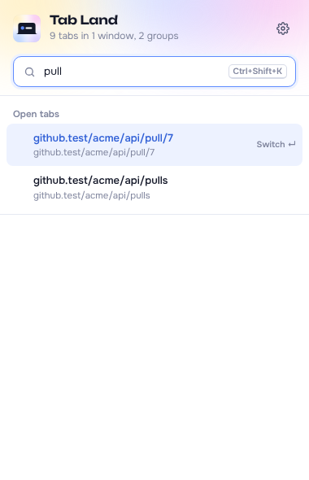
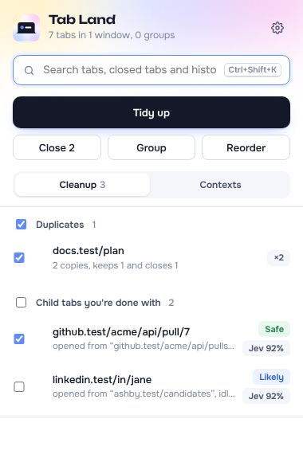
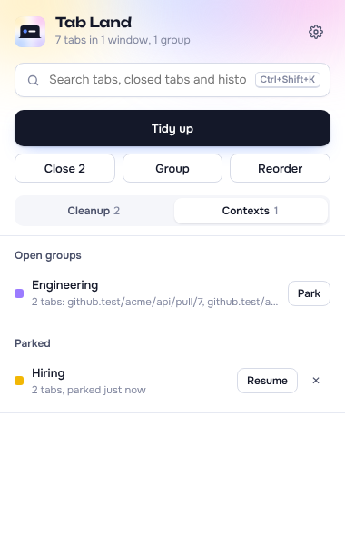
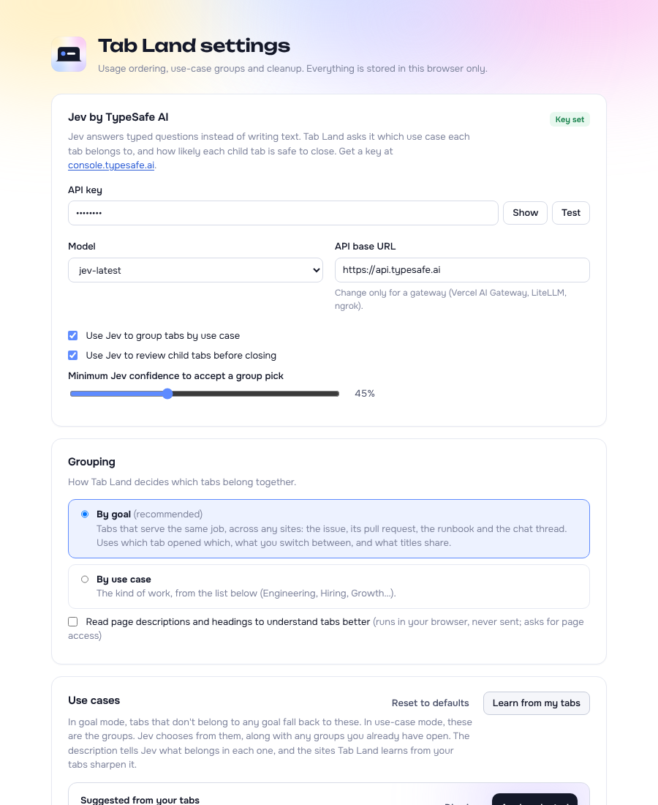
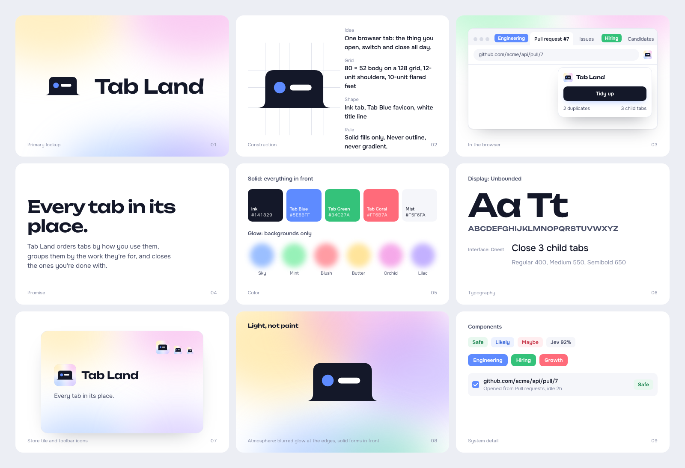

<p align="center">
  
</p>

<h1 align="center">Tab Land</h1>

<p align="center">
  A Chrome extension that keeps your tabs under control. It finds any tab fast, groups tabs by the job you're doing, and closes the tabs you don't need anymore.
</p>

<p align="center">
  
  &nbsp;
  
  &nbsp;
  
</p>

## What it does

### Find any tab fast
Press <kbd>⌘</kbd><kbd>⇧</kbd><kbd>K</kbd> on a Mac (<kbd>Ctrl</kbd><kbd>Shift</kbd><kbd>K</kbd> on Windows), type a few letters, and press Enter. Tab Land jumps to the tab. It also finds tabs you closed recently and pages from your history. The tabs you use most show up first.

### Group tabs by the job you're doing
Most work spreads across many sites. Fixing one bug might mean a ticket, a code change, a help doc and a chat thread, all on different websites. Tab Land puts those tabs in one group and names it after the job, like **ENG-482 Billing Retry** or **Jane Doe**.

To decide which tabs belong together, it looks for clues:
- **One tab opened the other.** You clicked a link in the ticket and it opened the code change.
- **You keep switching between them.** Going back and forth between two tabs is a strong sign they're part of the same job.
- **Their titles share words.** Rare words count more than common ones.
- **They share a code or number,** like a ticket number (`ENG-482`) or an order number.
- **You opened them at about the same time.**

Being on the same website is **not** a clue. Two GitHub tabs for two different projects stay apart.

If you add a Jev API key (see below), Jev double-checks each group, takes out tabs that don't fit, and names groups when the tabs share no words.

**Grouping again** only adds new tabs to the groups Tab Land already made. It keeps their names, and it never touches groups you made yourself.

**Regroup everything** starts over. Use it when you switch grouping styles. It's in the popup, in Settings, and on <kbd>Alt</kbd>+<kbd>Shift</kbd>+<kbd>G</kbd>. Tab Land saves your current groups first, so **Undo regroup** can put them back.

Prefer the old style? In Settings, switch from **By goal** to **By use case**. That groups tabs by the type of work instead (Engineering, Hiring, Growth, and so on).

### Move and merge tabs by saying so
Open the popup and switch to **Ask** (or type `>` in the search box). Then say what you want in your own words. Typos and loose wording are fine:
- "Can you move linked in out of Growth"
- "Merge Growth 2 into Growth"
- "Put the dashboards and funnel reports in a new group called Metrics"
- "Growth 2 should really be Paid growth"
- "Ungroup Research"

Ask needs a Jev API key. Jev reads your request, along with your group names and a few tab titles from each group, and answers a set of questions about it: what you want done, which group, and what the new name is. A new name is always copied from the words you typed. When tabs have to move, Jev also checks each tab against your request.

When Jev is sure, the change happens right away and you get an **Undo** button. When it's fairly sure, it asks "Rename Hiring to Recruiting?" first. When it's unsure, it asks you to pick, for example which group you meant, or whether a close-call tab belongs. Moves it had to guess at show you the tabs first, and nothing moves until you say so. If you rename a group to a name another group already has, it offers to merge the two.

Ask also lists groups that look like they should be one, with a one-tap **Merge**. Nothing you say is saved. Only the last change is kept, so you can undo it.

### Close the tabs you're done with
- **Duplicates:** the same page open twice. Tab Land keeps the best copy (the one you're using, pinned, or in a group) and closes the rest. Tracking codes in the link and `#section` jumps don't fool it.
- **Other versions of the same page:** the same address with different extras, like `?view=chart`, `?sort=new` or `#totals`. Tab Land treats the version you're using as the main page and the others as details of it. It keeps the one you use and closes the rest once they've gone unused for 10 minutes. Parts of the address that really change the page are respected, so two different YouTube videos, two different searches, or `?id=12` and `?id=13` stay separate.
- **Leftover tabs:** tabs you opened from another tab, like a search result or a link, and then stopped using. If the original tab is still open and the leftover has been sitting unused for a while, Tab Land offers to close it. Each one is marked **Safe**, **Likely** or **Maybe**.
- **Old sign-in pages** that were left behind.

Extra copies and versions close on their own after 10 minutes without use, every few minutes and right after you open a page that's already open. You can change the time or turn this off in Settings. Everything else waits for you to choose it, unless you turn on automatic cleanup. **Undo close** brings back the last tabs it closed, in the same spot and group.

### Put tabs in order
Groups are kept in **recently used last** order. The group you used most recently sits at the end of the window, and groups you haven't touched in a while drift to the start. Inside each group, the tab you used last sits at the end too.

Nothing moves while you're reading. Tab Land puts things in order every 20 minutes (the same interval as automatic tidy), and when you press **Reorder**. Pinned tabs stay where they are, and groups move together.

Prefer the old way? In Settings, pick **Most used first** to put the tabs you use most on the left.

### Save a group for later
In the **Contexts** view, **Park** saves a whole group and closes its tabs to free up memory. **Resume** brings the group back exactly as it was.

### Learn your kinds of work
Tab Land notices which sites you use for each kind of work. In Settings, **Learn from my tabs** suggests changes you can accept or skip:
- **Add** a new kind of work when it sees sites you always use together.
- **Update** a kind of work with the sites you actually use for it.
- **Remove** a kind of work you haven't used in two weeks.

## Install

1. Download this project. Open `chrome://extensions` and turn on **Developer mode** (top right).
2. Click **Load unpacked** and pick the project folder (the one with `manifest.json` in it).
3. The settings page opens. If you have a Jev API key from [console.typesafe.ai](https://console.typesafe.ai/settings/keys), paste it in, click **Test**, then **Save**. Tab Land works without a key, too; it just won't be as smart about groups.
4. Pin Tab Land to your toolbar.

Shortcuts:

| Keys | What it does |
|---|---|
| <kbd>⌘</kbd><kbd>⇧</kbd><kbd>K</kbd> | Open Tab Land and search |
| <kbd>Alt</kbd>+<kbd>Shift</kbd>+<kbd>T</kbd> | Tidy everything at once |
| <kbd>Alt</kbd>+<kbd>Shift</kbd>+<kbd>G</kbd> | Regroup everything from scratch |

You can change these at `chrome://extensions/shortcuts`.

<p align="center"></p>

## About Jev

Jev is an AI model from TypeSafe AI. It doesn't write text. It answers questions with choices and yes/no odds. Tab Land asks it things like "Do these tabs serve one goal?", "Which kind of work is this tab?", and "Is this leftover tab safe to close?" Then it mixes Jev's answers with its own clues.

## Privacy

- Everything Tab Land learns stays in your browser. Nothing is synced or uploaded.
- When you use Ask, Jev also sees what you typed and the names of your groups.
- Jev only sees a tab's title and the site and path of its address. Settings can hide either one. The rest of the address (the part after `?` or `#`) and what's on the page are never sent.
- In Settings, list sites Jev should never see, such as a health records system. Those tabs are never sent and never read.
- You can also list sites Tab Land should never close or move.
- Private (incognito) tabs are never saved and never sent.
- Your API key stays in your browser and only goes to the Jev address set in Settings.
- The optional "read page descriptions" setting reads the page inside your browser only. That text is never saved or sent.

## Brand

<p align="center"></p>

Tab Land's promise is "Every tab in its place." The logo is a simple dark browser tab with a blue dot and a white line, so it's easy to read even at toolbar size.

The look follows three rules:
- **Solid colors** for everything you click or read.
- **Soft glows** only in the background, in light yellow, pink, blue, purple and green.
- **White** pages with dark text.

| Color | Used for | Code |
|---|---|---|
| Ink | Text and main buttons | `#141829` |
| Tab Blue | The logo dot and highlights | `#5E8BFF` |
| Tab Green | Groups and "Safe" | `#34C27A` |
| Tab Coral | Groups, "Maybe" and delete actions | `#FF6B7A` |

The fonts are [Unbounded](https://github.com/googlefonts/unbounded) for the name and headings and [Onest](https://github.com/simpals/onest) for everything else. Both come with the extension. The full brand kit is in `docs/brand/brand-kit.html`.

## For developers

```bash
npm install
npm test            # run the tests
npm run check       # lint, type check, and tests with coverage (what CI runs)
npm run e2e         # run the extension in a real Chromium browser against fake sites
npm run icons       # rebuild the icons from code
```

There's no build step. Chrome loads the `src/` folder directly, so the project folder *is* the extension.

**How the code is organized**
- `src/lib/` holds the logic: matching links, scoring tabs, finding goals, ranking search results. It doesn't depend on Chrome, so it's easy to test.
- `src/bg/` is the background worker. Each part is handed the Chrome tools it needs instead of grabbing them directly. In tests, it gets a fake Chrome (`tests/fakes/chrome.js`) that can act out tricky situations: a tab closing mid-action, a full storage area, a slow network, a browser restart.
- `src/ui/` holds the popup and settings pages.
- `tests/` holds the tests (71 fast ones, plus 15 that run in a real browser). GitHub runs all of them on every push.

**Built to not break**
- Only one action changes your tabs at a time.
- Every tab is checked again right before it's closed. If you started using it, pinned it, or it's playing sound, Tab Land leaves it alone.
- If Jev is slow or the key is wrong, Tab Land stops waiting and keeps working without it.
- If saved data gets damaged, Tab Land replaces the bad parts instead of crashing.

## License

[Apache License 2.0](LICENSE). The fonts use the SIL Open Font License 1.1; see [NOTICE](NOTICE).
